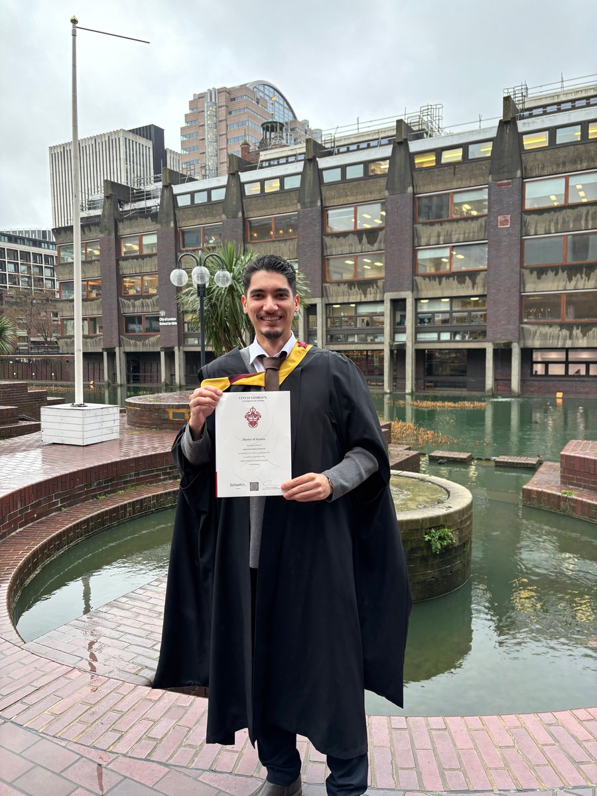

::: {.about-intro}

I'm a systematic trader and macro analyst based in London. I trade US index markets during the New York session as part of a small team, working to a rule-based process that I designed, documented and backtested. Alongside trading, I build and maintain a public macro dashboard that tracks the US Treasury yield curve and ISM data. I hold an MSc in Financial Economics (Distinction) from City, University of London.
:::

## Experience

### Independent Trader [Oct 2024 – Present]{.cv-dates}

Self-employed, small trading team

- Trade US index markets, primarily the Dow Jones, during the New York session as part of a small team working to a shared written rulebook.
- Designed and documented a rule-based intraday trading framework (in development since 2023) and tested it through backtesting.
- Built supporting MQL4/MQL5 tools and data-quality checks for the framework.
- Coordinate daily market preparation and review, and keep structured records of decisions and outcomes. The strategy, rules and tools were built through self-directed study.

### Sales Advisor (Part-time) [Jul 2026 – Present]{.cv-dates}

ARKET, London

- Work across shop floor, tills, stockroom and deliveries in a busy central London store.

### Equity Analyst Intern [Jun 2023 – Sep 2023]{.cv-dates}

Farabi Financial Group

- Conducted fundamental equity research across oil and gas, banking and financial institutions, supporting valuation work and buy, sell and hold recommendations.
- Built DCF and comparable company models in Excel and wrote investment reports, presenting findings to senior analysts and portfolio managers.
- Screened, retrieved and validated company and market data on Bloomberg Terminal, and monitored earnings releases, central bank policy, CPI, PMI and yield curve movements.
- Automated recurring data extraction and screening tasks in Python, reducing manual work and improving the consistency of research inputs.

### Engineering Intern [Oct 2022 – Nov 2022]{.cv-dates}

Fajr Energy Company

- Analysed reliability and operational risk data for industrial systems, identifying patterns relevant to equipment lifecycle management.
- Reviewed technical documentation and maintenance records, reaching defensible conclusions from incomplete real-world data.

## Education

### MSc Financial Economics (Distinction) [Sep 2024 – Sep 2025]{.cv-dates}

City, University of London

- Thesis: *Momentum in Financial Markets*. Time-series and cross-sectional momentum across equities, commodities, FX and bonds, tested in Python with regression and hypothesis testing.
- Modules: Asset Pricing, Econometrics, Derivatives, Portfolio Theory, Macroeconomics.

### BSc Mechanical Engineering [Sep 2019 – Oct 2023]{.cv-dates}

Amirkabir University of Technology

- Strong quantitative and analytical foundation, with applied modelling and data interpretation skills transferable to finance.

## Skills & certifications

- **Equity research:** fundamental company and sector analysis, financial statements and peer data, DCF and comparable company valuation, sensitivity testing, earnings monitoring, written investment reports and recommendations
- **Trading:** systematic strategy design, rule-based execution, backtesting, risk and drawdown control, trade record keeping, US index markets
- **Macro and research:** US Treasury yield curve, investment-grade and high-yield credit spreads, ISM/PMI, CPI, central bank policy
- **Programming and data:** Python (pandas, NumPy, matplotlib, Streamlit), MQL4/MQL5, VBA, MATLAB, STATA, data validation, automated testing
- **Platforms and tools:** Bloomberg Terminal, MetaTrader 5, NinjaTrader, Quantower, Excel (advanced modelling, pivot tables, macro-enabled workbooks), Word, PowerPoint
- **Certifications:** CFA Level 1 Candidate (sitting February 2027), Bloomberg Market Concepts, Bloomberg Spreadsheet Analysis
- **Languages:** Persian (native), English (fluent)

A CV tailored to a specific role is available on [request](mailto:mo.heidari24@gmail.com).
